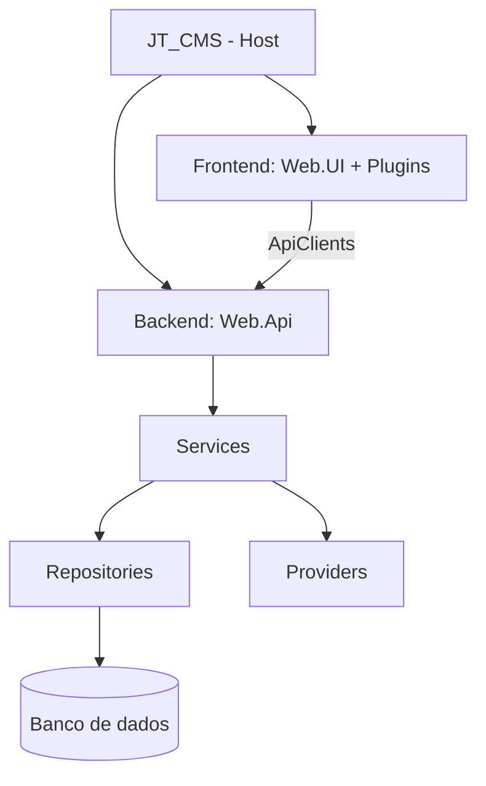

# JT_CMS

CMS de código aberto construído com **.NET 9 + Blazor**, com editor visual de páginas (*Site Builder*), múltiplos sites, plugins, templates e suporte a vários bancos de dados.

<!--

-->

## ✨ Funcionalidades

- Editor visual de páginas com plugins arrastáveis (Site Builder)
- Multi-site, layouts, blocos reutilizáveis e templates (`Blank`, `Default`, `Portfolio`)
- Conteúdos dinâmicos via *Content Types* (blog, projetos etc.)
- Gerenciador de arquivos, usuários, papéis, permissões e tokens de API
- API REST com Swagger
- Persistência plugável: LiteDB, MongoDB, SQLite, SQL Server, MySQL e PostgreSQL
- Providers substituíveis: e-mail, cache, storage, mensageria, tokens e renderização de templates

## 🧱 Arquitetura



## 📁 Estrutura

| Diretório | Descrição |
|---|---|
| [`src/Backend`](src/Backend/README.md) | API, serviços, entidades, identity e repositórios |
| [`src/Frontend`](src/Frontend/README.md) | UI Blazor, biblioteca de componentes, Tailwind builder e plugins |
| [`src/Providers`](src/Providers/README.md) | Provedores de infraestrutura |
| [`src/JT_CMS`](src/JT_CMS/README.md) | Host executável e templates de site |
| [`src/JT_CMS.Shared`](src/JT_CMS.Shared/README.md) | Tipos compartilhados |
| [`docs`](docs/README.md) | Documentação e imagens |

Cada diretório de projeto possui seu próprio `README.md`.

## 🚀 Executando

Pré-requisitos: [.NET 9 SDK](https://dotnet.microsoft.com/download) (e Node.js apenas se for recompilar os estilos SCSS).

```bash
git clone <url-do-repositorio>
cd JT_CMS
dotnet run --project src/JT_CMS
```

Acesse `http://localhost:5000` e conclua o assistente de **Setup**.

## ⚙️ Configuração

Edite `src/JT_CMS/appsettings.json` (banco, JWT, SMTP, storage e API tokens). Detalhes em [src/JT_CMS/README.md](src/JT_CMS/README.md).

> ⚠️ Substitua os segredos e credenciais de exemplo antes de usar em produção.

## 🤝 Contribuindo

Siga as convenções de [src/GUIDELINE.md](src/GUIDELINE.md) (Conventional Commits, nomes completos, atributos ordenados).

## 🖼️ Imagens

Todas as imagens da documentação ficam em [`docs/images`](docs/images/), organizadas por módulo.
