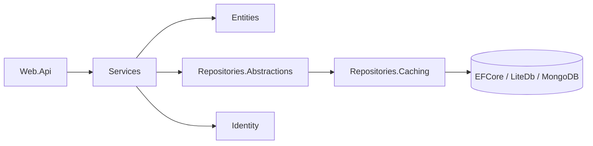

# Backend

Camadas de servidor do JT_CMS (API REST, regras de negócio, entidades e persistência).

| Projeto | Descrição |
|---|---|
| [JT_CMS.Entities](JT_CMS.Entities/README.md) | Entidades de domínio |
| [JT_CMS.Identity](JT_CMS.Identity/README.md) | ASP.NET Identity (`UserStore`) |
| [JT_CMS.Services](JT_CMS.Services/README.md) | Serviços de aplicação e permissões |
| [JT_CMS.Web.Api](JT_CMS.Web.Api/README.md) | Controllers REST, filtros e Swagger |
| [Repositories](Repositories/README.md) | Abstrações e implementações de persistência |

## 🖼️ Imagens

> Coloque as imagens desta seção em [`docs/images/backend/services`](../../docs/images/backend/services/).

<!--
Exemplo de uso (descomente após adicionar a imagem):

-->
